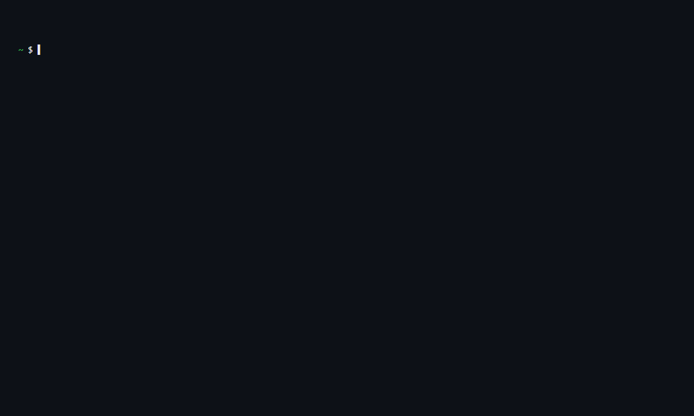
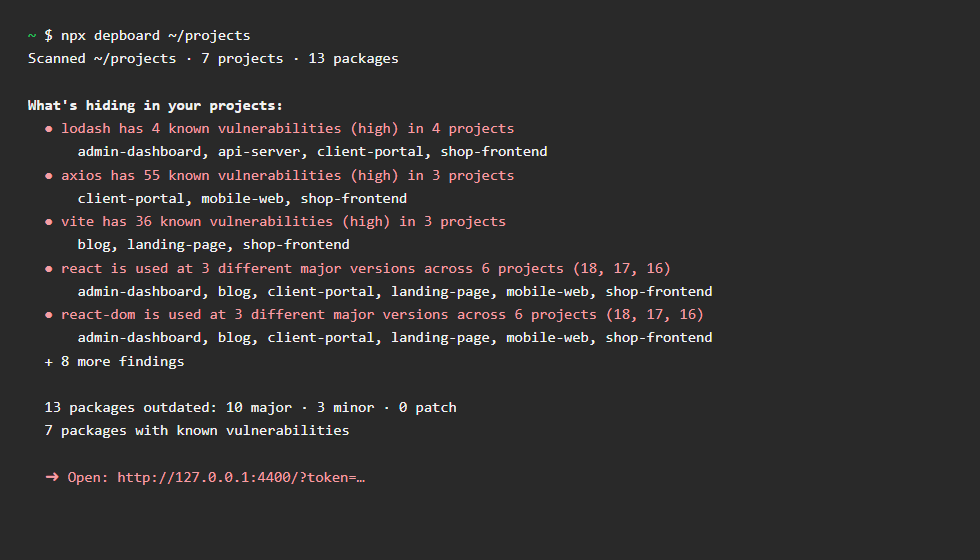
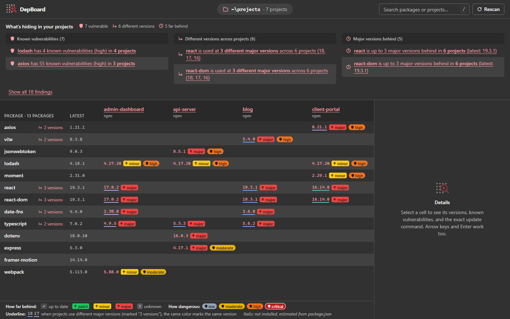
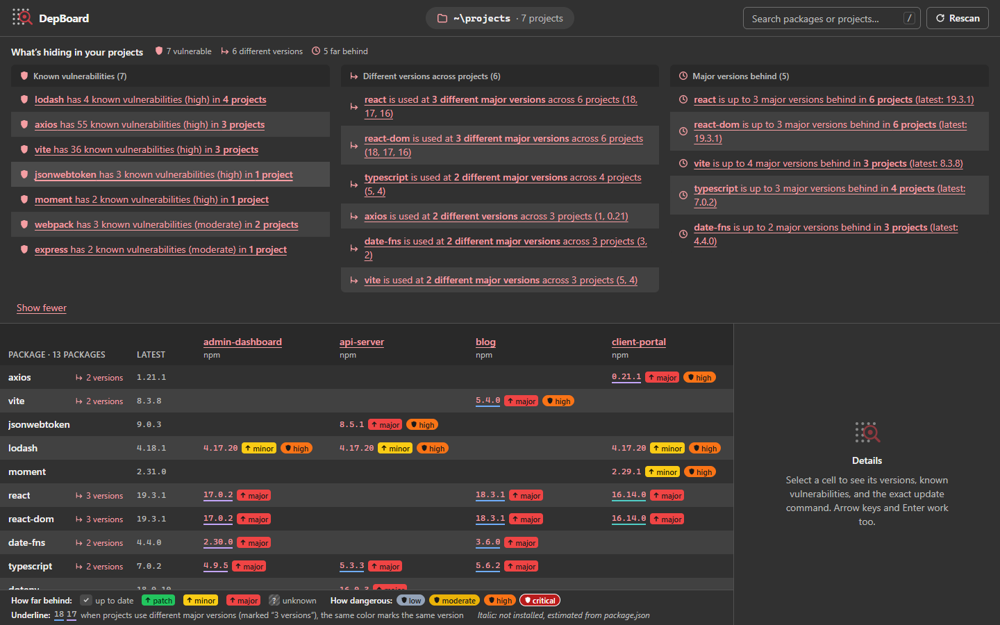
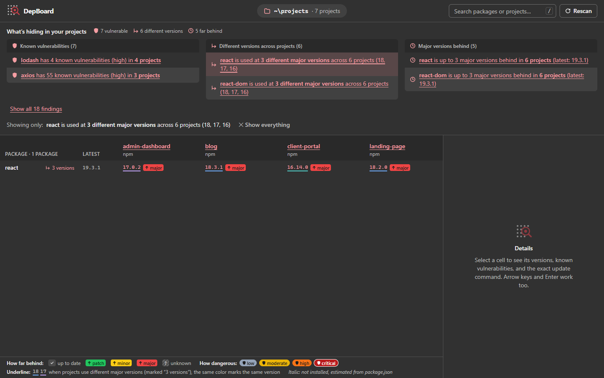
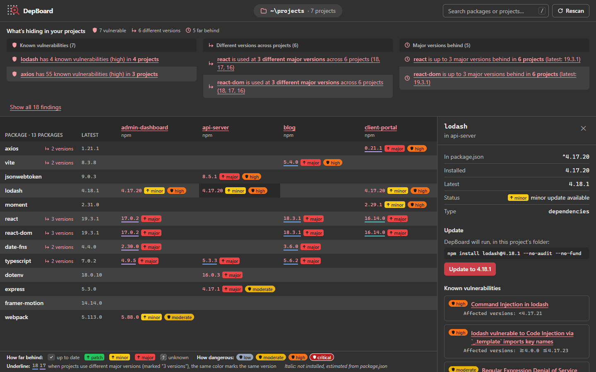
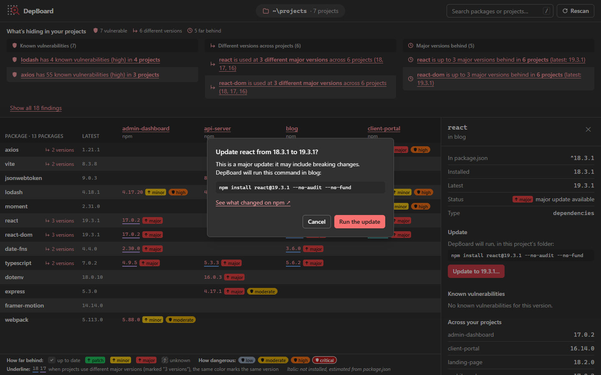
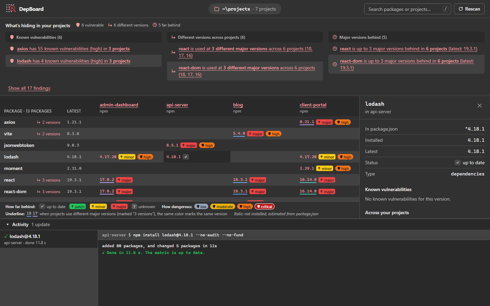
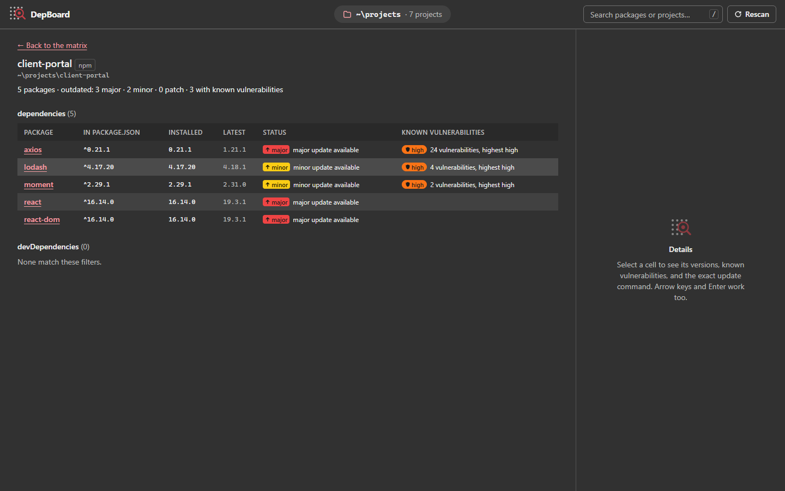

<div dir="rtl">

<p align="center">
  
</p>

<h1 align="center">DepBoard</h1>

<p align="center">
  <strong>اكتشف ما يختبئ في مشاريعك خلال 10 ثوانٍ.</strong>
</p>

<p align="center">
  <a href="https://www.npmjs.com/package/depboard"></a>
  <a href="https://ci.appveyor.com/project/aaas72/depboard/branch/main"></a>
  <a href="https://github.com/aaas72/depboard/blob/main/LICENSE"></a>
  
</p>

<p align="center">
  <a href="README.md">English</a> · <strong>العربية</strong>
</p>

<div dir="ltr">

```bash
npx depboard ~/projects
```

</div>

<p align="center">
  
</p>

كل أدوات الاعتماديات تجيب عن سؤال: _"ما الحزم القديمة في **هذا** المشروع؟"_. أمّا **DepBoard** فيجيب عن السؤال الذي لا تجيب عنه أي أداة أخرى: _"ماذا يحدث عبر **جميع** مشاريعي في آنٍ واحد؟"_

وجّهه إلى المجلد الذي يضم مشاريعك، ليفتح في متصفحك مصفوفة واحدة تعرض كل حزمة مقابل كل مشروع، ويخبرك بجمل واضحة عمّا لم تكن تدركه: مثل أن `react` تعمل بثلاثة إصدارات رئيسية مختلفة عبر ستة مشاريع، أو أن نسخة مصابة بثغرة من `lodash` موجودة في أربعة منها.

بلا حساب، وبلا ملفات إعداد، ودون رفع أي كود. يعمل بالكامل على جهازك ويتوقف فور إغلاقه.

## المحتويات

- [البدء السريع](#البدء-السريع)
- [كيف يعمل خطوة بخطوة](#كيف-يعمل-خطوة-بخطوة)
- [الشاشات](#الشاشات)
- [المميزات](#المميزات)
- [لماذا DepBoard؟](#لماذا-depboard)
- [الخصوصية والأمان](#الخصوصية-والأمان)
- [التوثيق](#التوثيق) · [المساهمة](#المساهمة) · [الترخيص](#الترخيص)

## البدء السريع

تحتاج إلى [Node.js](https://nodejs.org) بالإصدار `20.19` أو أحدث.

<div dir="ltr">

```bash
npx depboard                       # المجلد الحالي
npx depboard ~/projects            # مجلد واحد
npx depboard ~/work ~/clients      # عدة مجلدات في مصفوفة واحدة
npx depboard ~/projects --summary  # طباعة الملاحظات في الطرفية والخروج
```

</div>

| الخيار            | وظيفته                                                             |
| ----------------- | ------------------------------------------------------------------ |
| `--port <n>`      | المنفذ الذي يستمع عليه الخادم المحلي (الافتراضي: منفذ متاح عشوائي) |
| `--no-open`       | طباعة الرابط بدلاً من فتح المتصفح تلقائياً                           |
| `--summary`       | طباعة الملاحظات والخروج فوراً دون خادم أو متصفح                     |
| `--depth <n>`     | أقصى عمق للبحث عن المشاريع داخل المجلدات (الافتراضي: `6`)          |
| `-y`, `--yes`     | تخطّي رسائل التأكيد التفاعلية                                       |
| `--debug`         | طباعة سجلات تفصيلية على `stderr`                                   |
| `-v`, `--version` | طباعة رقم الإصدار                                                  |

هل تستخدمه للمرة الأولى؟ ابدأ بدليل [البدء (Getting started)](https://github.com/aaas72/depboard/blob/main/docs/guide/getting-started.md) و[قراءة المصفوفة (Reading the matrix)](https://github.com/aaas72/depboard/blob/main/docs/guide/reading-the-matrix.md).

## كيف يعمل خطوة بخطوة

### 1. شغّله على المجلد الذي يضم مشاريعك

<div dir="ltr">

```bash
npx depboard ~/projects
```

</div>

يقوم `npx` بتنزيل DepBoard عند أول استخدام دون الحاجة إلى تثبيت مسبق، ويفحص المجلد الذي حددته وما تحته فقط، ولا يمس بقية القرص أبداً.

### 2. اقرأ الملخص في الطرفية

خلال ثوانٍ معدودة، تجيبك الطرفية قبل حتى أن يفتح المتصفح:

<div dir="ltr">

```text
Scanned ~/projects · 7 projects · 13 packages

What's hiding in your projects:
  ● lodash has 4 known vulnerabilities (high) in 4 projects
      admin-dashboard, api-server, client-portal, shop-frontend
  ● axios has 55 known vulnerabilities (high) in 3 projects
      client-portal, mobile-web, shop-frontend
  ● vite has 36 known vulnerabilities (high) in 3 projects
      blog, landing-page, shop-frontend
  ● react is used at 3 different major versions across 6 projects (18, 17, 16)
      admin-dashboard, blog, client-portal, landing-page, mobile-web, shop-frontend
  ● react-dom is used at 3 different major versions across 6 projects (18, 17, 16)
      admin-dashboard, blog, client-portal, landing-page, mobile-web, shop-frontend
  + 8 more findings

  13 packages outdated: 10 major · 3 minor · 0 patch
  7 packages with known vulnerabilities

  ➜ Open: http://127.0.0.1:4400/?token=…
  Press Ctrl+C to stop.
```

</div>

| السطر                 | ماذا يخبرك                                                 |
| --------------------- | ---------------------------------------------------------- |
| `Scanned …`           | المجلد الذي فُحص بالضبط، وعدد المشاريع والحزم المكتشفة      |
| `● …`                 | أهم الملاحظات المكتشفة مع أسماء المشاريع المتأثرة بكل منها |
| `… packages outdated` | عدد الحزم المتأخرة ومقدار تأخرها                           |
| `➜ Open: …`           | رابط الواجهة الكاملة برمز جلسة (token) جديد في كل تشغيل    |

### 3. استكشف المصفوفة في متصفحك

يفتح المتصفح الرابط تلقائياً (أو افتحه بنفسك، أو مرّر `--no-open`): كل حزمة مقابل كل مشروع، وأهم الملاحظات في الأعلى.

### 4. تتبّع ملاحظة ثم نفّذ الإجراء

- **اضغط على أي ملاحظة** لتضييق المصفوفة على تلك الحزمة والمشاريع المعنية بها فقط.
- **اختر خلية** لعرض الإصدارات، وكل التحذيرات الأمنية المنشورة، وأمر التحديث الدقيق.
- **اضغط Update** لتشغيل ذلك الأمر في ذلك المشروع (لمشاريع npm؛ وتحديثات `major` تطلب تأكيداً إضافياً أولاً). تُعرض المخرجات مباشرة وتتحدث المصفوفة تلقائياً فور الانتهاء.

### 5. أوقفه

اضغط `Ctrl+C` في الطرفية؛ يوقف DepBoard خادمه المحلي ولا يترك وراءه أي ملفات أو ذاكرة مؤقتة أو عمليات في الخلفية.

### الطرفية فقط؟

الخيار `--summary` يطبع الملاحظات نفسها ويخرج فوراً بلا خادم ولا متصفح؛ عملي عبر SSH وفي السكربتات وبيئات CI:

<div dir="ltr">

```bash
npx depboard ~/projects --summary
```

</div>

## الشاشات

جميع شاشات DepBoard بالترتيب الذي تصادفها به (اضغط على أي صورة لعرضها بالحجم الكامل):

<table>
  <tr>
    <td width="50%" valign="top">
      <a href="https://raw.githubusercontent.com/aaas72/depboard/main/docs/media/screenshots/terminal.png"></a>
      <p><strong>1 · ملخص الطرفية</strong><br>أهم الملاحظات قبل فتح أي متصفح؛ ويتوقف الخيار <code>--summary</code> عند هذه الخطوة.</p>
    </td>
    <td width="50%" valign="top">
      <a href="https://raw.githubusercontent.com/aaas72/depboard/main/docs/media/screenshots/overview.png"></a>
      <p><strong>2 · المصفوفة</strong><br>كل حزمة مقابل كل مشروع، مع شريط الملاحظات في الأعلى ولوحة التفاصيل الجانبية.</p>
    </td>
  </tr>
  <tr>
    <td width="50%" valign="top">
      <a href="https://raw.githubusercontent.com/aaas72/depboard/main/docs/media/screenshots/all-findings.png"></a>
      <p><strong>3 · جميع الملاحظات</strong><br>عمود مستقل لكل فئة: الثغرات الأمنية، وتفاوت الإصدارات، والتأخر بإصدارات رئيسية.</p>
    </td>
    <td width="50%" valign="top">
      <a href="https://raw.githubusercontent.com/aaas72/depboard/main/docs/media/screenshots/drift-focus.png"></a>
      <p><strong>4 · التركيز على ملاحظة</strong><br>عند الضغط على ملاحظة تضيق المصفوفة لتعرض تلك الحزمة ومشاريعها فقط.</p>
    </td>
  </tr>
  <tr>
    <td width="50%" valign="top">
      <a href="https://raw.githubusercontent.com/aaas72/depboard/main/docs/media/screenshots/cell-details.png"></a>
      <p><strong>5 · تفاصيل الخلية</strong><br>الإصدار المصرّح به والمثبّت والأحدث، وتفاصيل كل ثغرة، وأمر التحديث الدقيق.</p>
    </td>
    <td width="50%" valign="top">
      <a href="https://raw.githubusercontent.com/aaas72/depboard/main/docs/media/screenshots/update-confirm.png"></a>
      <p><strong>6 · تأكيد التحديث الرئيسي</strong><br>يعرض الأمر الدقيق ورابط سجل الإصدارات، ويكون التركيز الافتراضي على زر الإلغاء.</p>
    </td>
  </tr>
  <tr>
    <td width="50%" valign="top">
      <a href="https://raw.githubusercontent.com/aaas72/depboard/main/docs/media/screenshots/update-output.png"></a>
      <p><strong>7 · التحديث المباشر</strong><br>تتدفق مخرجات الأمر لحظياً، وتتحدث المصفوفة فور اكتماله بنجاح.</p>
    </td>
    <td width="50%" valign="top">
      <a href="https://raw.githubusercontent.com/aaas72/depboard/main/docs/media/screenshots/project.png"></a>
      <p><strong>8 · عرض مشروع واحد</strong><br>جميع حزم مشروع بعينه مقسّمة إلى <code>dependencies</code> و<code>devDependencies</code>، والأكثر إلحاحاً أولاً.</p>
    </td>
  </tr>
</table>

## المميزات

- **اكتشافات مصاغة بجمل واضحة:** الثغرات المعروفة، والحزم المستخدمة بإصدارات رئيسية متباينة، والمشاريع المتأخرة كثيراً؛ اضغط على أي ملاحظة للتركيز عليها.
- **شارات واضحة بذاتها:** مقدار التأخر (`↑ patch`، `↑ minor`، `↑ major`) ومستوى الخطورة (`low`، `moderate`، `high`، `critical`)، مع تمييز التفاوت اللوني تحت كل إصدار (`↳ 3 versions`).
- **كل مشاريعك دفعة واحدة:** مجلد واحد أو عدة مجلدات، وكل ملف `package.json` تحتها، مع الإصدار المثبّت فعلياً في كل مشروع.
- **نتائج مبنية على ما هو مثبّت فعلاً:** لا تُبلَّغ ثغرة إلا لإصدار مثبّت فعلياً، ولا يُبلَّغ تفاوت إلا بين خطوط إصدار رئيسية حقيقية.
- **فحص الثغرات المعروفة** من قاعدة بيانات npm الرسمية (نفس المصدر الذي يعتمد عليه `npm audit`) عبر طلب مجمّع واحد لكل مشاريعك.
- **شاشة مستقلة لكل مشروع:** تعرض جميع حزمه مرتبة حسب الأولوية.
- **التحديث من المتصفح:** حزمة واحدة في مشروع npm واحد، مع عرض الأمر الدقيق مسبقاً وتأكيد إضافي للتحديثات الرئيسية وبث مباشر للمخرجات.
- **ملخص في الطرفية** عبر `--summary` للسكربتات وبيئات CI.
- **سريع:** قرابة 5 ثوانٍ لفحص 30 مشروعاً؛ ويفشل فحص الجودة إن تجاوزت المدة 10 ثوانٍ.
- **دعم الـ Monorepos كمشروع واحد:** تظهر مساحات عمل npm وyarn وbun وpnpm في عمود واحد مع تفصيل إصدار كل حزمة فرعية في لوحة التفاصيل.
- **يعمل في كل مكان:** أنظمة Windows وmacOS وLinux؛ ويقرأ مشاريع npm وpnpm وyarn وbun.

**المخطط له قادماً:** قراءة الإصدارات الدقيقة من ملفات القفل للمشاريع غير المثبّتة، وفحص ثغرات الاعتماديات غير المباشرة، ودعم التحديث لمشاريع pnpm وyarn وbun وداخل مشاريع الـ monorepo. راجع [خارطة الطريق](https://github.com/aaas72/depboard/blob/main/docs/roadmap.md).

## لماذا DepBoard؟

الأدوات أدناه ممتازة فيما صُممت له، ولا يأتي DepBoard بديلاً عنها، بل يضيف الزاوية التي لا توفرها أي منها: **رؤية جميع مشاريعك جنباً إلى جنب**.

| الأداة                    | نطاق الفحص               | طريقة التشغيل                   |
| ------------------------- | ------------------------ | ------------------------------- |
| `npm outdated`, ncu, taze | مشروع واحد في كل مرة     | مخرجات نصية في الطرفية          |
| `npm audit`               | مشروع واحد في كل مرة     | مخرجات نصية في الطرفية          |
| npm-gui                   | مشروع واحد في كل مرة     | واجهة متصفح محلية               |
| Renovate, Dependabot      | مستودع واحد في كل مرة    | خدمة سحابية عبر طلبات دمج (PRs) |
| **DepBoard**              | **كل مشروع داخل المجلد** | **واجهة متصفح محلية**           |

## الخصوصية والأمان

يكتفي DepBoard بقراءة مشاريعك، ولا يكتب فيها أي شيء ما لم تؤكد تحديثاً بنفسك.

- **لا يغادر جهازك سوى أسماء الحزم وإصداراتها** المرسلة إلى سجل npm العام لمعرفة أحدث الإصدارات والتحذيرات الأمنية؛ بلا مسارات ملفات، ولا كود، ولا تتبع (telemetry)، ولا حسابات.
- **يستمع الخادم المحلي على `127.0.0.1` حصراً،** ويتطلب كل طلب رمز جلسة يُنشأ خصيصاً للتشغيل الحالي، مع رفض أي طلبات قادمة من مواقع أخرى.
- **تنفَّذ التحديثات بتشغيل `npm` مباشرة دون المرور عبر غلاف الأوامر (shell)،** ولحزمة مصرَّح بها مسبقاً في المشروع وبإصدار محدد بعد تأكيدك.

للتفاصيل: [الخصوصية والأمان](https://github.com/aaas72/depboard/blob/main/docs/guide/privacy-and-security.md) · [النموذج الأمني](https://github.com/aaas72/depboard/blob/main/docs/security-model.md). هل عثرت على ثغرة أمنية؟ يرجى الإبلاغ عنها بشكل خاص عبر [SECURITY.md](https://github.com/aaas72/depboard/blob/main/SECURITY.md).

## التوثيق

يفحص DepBoard المجلدات التي تختارها، ويقرأ الإصدارات المصرّح بها والمثبّتة في كل مشروع، ويستعلم من سجل npm عن أحدث الإصدارات والتحذيرات الأمنية، ثم يحوّل النتيجة إلى مصفوفة وملاحظات مرتبة حسب الأهمية. يقدّم خادم محلي صغير على `127.0.0.1` الواجهة وينفّذ كل العمليات، بينما يقتصر دور المتصفح على العرض. يشرح ملف [البنية المعمارية](https://github.com/aaas72/depboard/blob/main/docs/architecture.md) كيفية ترابط هذه الأجزاء.

- **استخدام DepBoard:** [البدء](https://github.com/aaas72/depboard/blob/main/docs/guide/getting-started.md) · [قراءة المصفوفة](https://github.com/aaas72/depboard/blob/main/docs/guide/reading-the-matrix.md) · [تحديث الحزم](https://github.com/aaas72/depboard/blob/main/docs/guide/updating.md) · [مرجع سطر الأوامر](https://github.com/aaas72/depboard/blob/main/docs/guide/cli.md) · [استكشاف الأخطاء وإصلاحها](https://github.com/aaas72/depboard/blob/main/docs/guide/troubleshooting.md)
- **المساهمة:** [دليل المساهمة](https://github.com/aaas72/depboard/blob/main/.github/CONTRIBUTING.md) · [البنية المعمارية](https://github.com/aaas72/depboard/blob/main/docs/architecture.md) · [النموذج الأمني](https://github.com/aaas72/depboard/blob/main/docs/security-model.md) · [إرشادات الواجهة](https://github.com/aaas72/depboard/blob/main/docs/ui-guidelines.md) · [سجلات القرارات المعمارية](https://github.com/aaas72/depboard/tree/main/docs/adr)
- **المشروع:** [خارطة الطريق](https://github.com/aaas72/depboard/blob/main/docs/roadmap.md) · [سجل التغييرات](https://github.com/aaas72/depboard/blob/main/packages/cli/CHANGELOG.md) · [ميثاق السلوك](https://github.com/aaas72/depboard/blob/main/.github/CODE_OF_CONDUCT.md)

## المساهمة

نرحّب بالقضايا وطلبات الدمج. تصفّح قضايا [`good first issue`](https://github.com/aaas72/depboard/labels/good%20first%20issue) و[`help wanted`](https://github.com/aaas72/depboard/labels/help%20wanted)، وعلّق على القضية التي ترغب بالعمل عليها وانتظر حتى يتم إسنادها إليك قبل البدء. يوضّح [دليل المساهمة](https://github.com/aaas72/depboard/blob/main/.github/CONTRIBUTING.md) كامل المسار من عمل Fork وإعداد البيئة حتى فحوصات AppVeyor والمراجعة والدمج.

## الترخيص

مرخّص بموجب رخصة [MIT](https://github.com/aaas72/depboard/blob/main/LICENSE). تتضمن الحزمة المنشورة اعتماديات مفتوحة المصدر مدمجة (مثل Fastify وReact وغيرها) تحت رخص متساهلة؛ وتُرفق إشعاراتها في `dist/THIRD_PARTY_LICENSES.md`.

</div>
