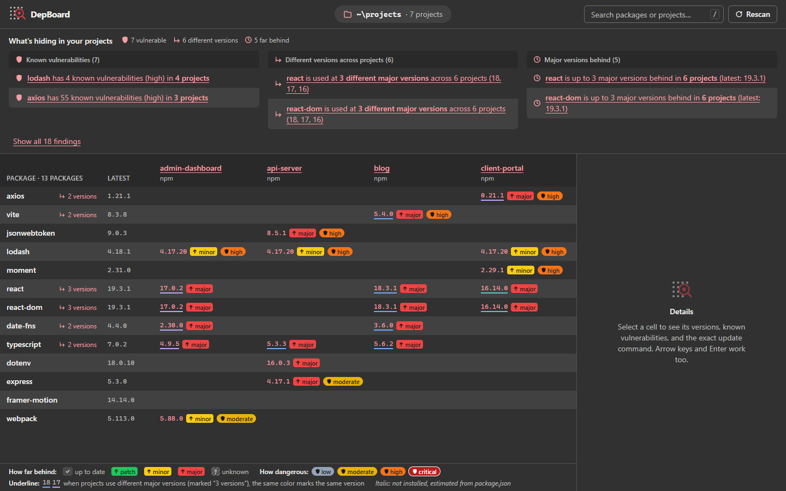
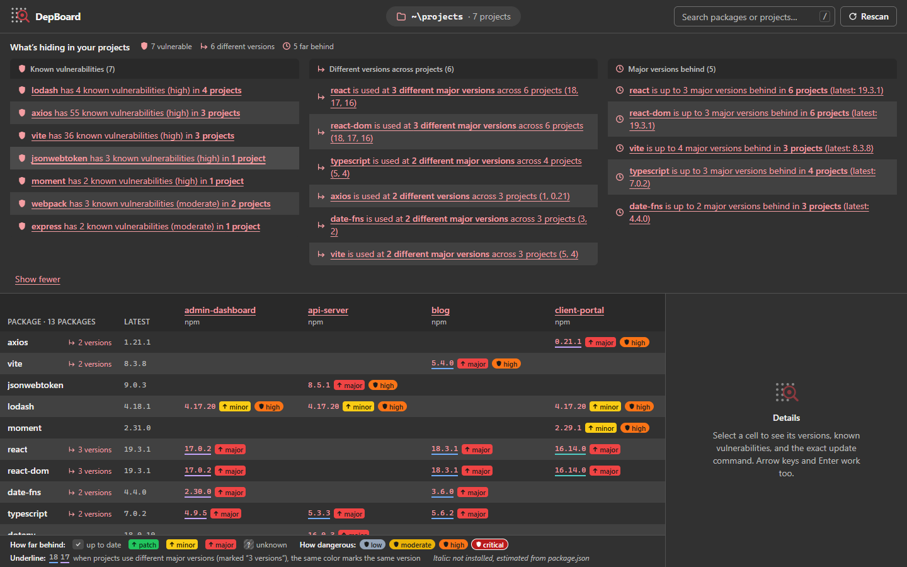
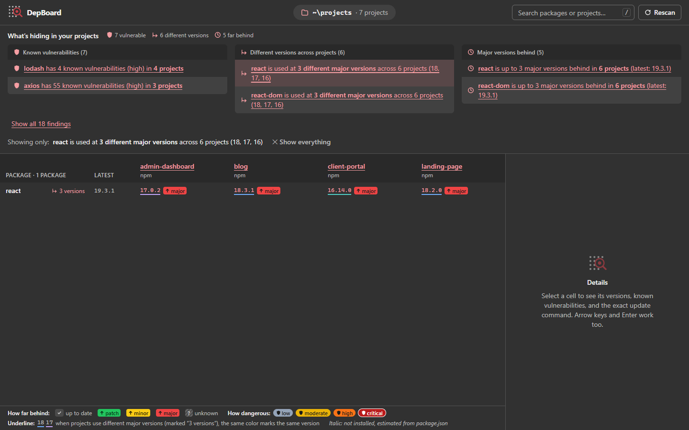
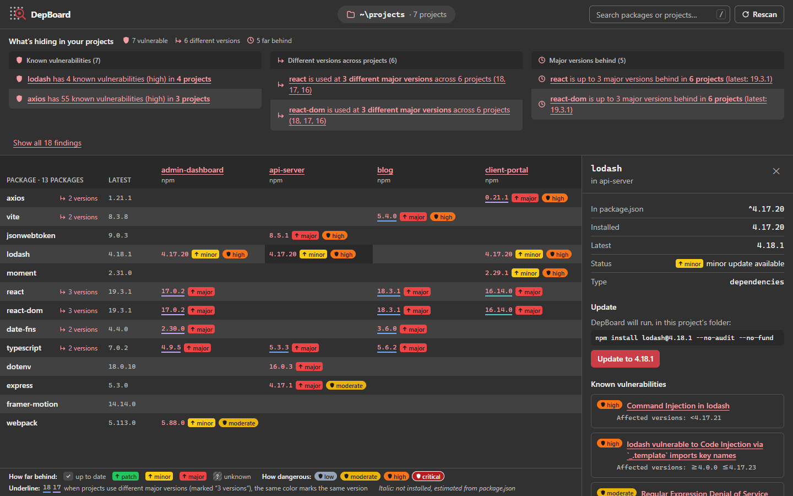

<p align="center">
  
</p>

<h1 align="center">DepBoard</h1>

<p align="center">
  <strong>Discover what's hiding in your projects in 10 seconds.</strong>
</p>

<p align="center">
  <a href="https://github.com/aaas72/depboard/blob/main/LICENSE"></a>
  
</p>

```bash
npx depboard ~/projects
```

<p align="center">
  
</p>

Every dependency tool answers _"what is outdated in **this** project?"_. DepBoard answers the question
none of them do: _"what is happening across **all** my projects at once?"_

Point it at the folder that holds your projects. It opens one matrix in your browser, every package
against every project, and tells you in plain sentences what you didn't know: that React runs at
three different major versions across six projects, or that a vulnerable lodash sits in four of
them.

No account. No config. Nothing uploaded. It runs on your machine and stops when you close it.

## How it works, step by step

### 1. Run it on the folder that holds your projects

```bash
npx depboard ~/projects
```

`npx` downloads DepBoard the first time; there is nothing to install. It scans only the folder you
give it (and everything below it), never the rest of your disk.

### 2. Read the summary in your terminal

A few seconds later, the terminal answers the question before any browser opens:

```text
Scanned ~/projects · 7 projects · 13 packages

What's hiding in your projects:
  ● lodash has 4 known vulnerabilities (high) in 4 projects
      admin-dashboard, api-server, client-portal, shop-frontend
  ● axios has 55 known vulnerabilities (high) in 3 projects
      client-portal, mobile-web, shop-frontend
  ● vite has 36 known vulnerabilities (high) in 3 projects
      blog, landing-page, shop-frontend
  ● react is used at 3 different major versions across 6 projects (18, 17, 16)
      admin-dashboard, blog, client-portal, landing-page, mobile-web, shop-frontend
  ● react-dom is used at 3 different major versions across 6 projects (18, 17, 16)
      admin-dashboard, blog, client-portal, landing-page, mobile-web, shop-frontend
  + 8 more findings

  13 packages outdated: 10 major · 3 minor · 0 patch
  7 packages with known vulnerabilities

  ➜ Open: http://127.0.0.1:4400/?token=…
  Press Ctrl+C to stop.
```

| Line                  | What it tells you                                                 |
| --------------------- | ----------------------------------------------------------------- |
| `Scanned …`           | Exactly which folder was read, and how many projects and packages |
| `● …`                 | The most important findings, with the projects each one affects   |
| `… packages outdated` | How many packages are behind, by how much                         |
| `➜ Open: …`           | The link to the full picture. Its token is new on every run       |

### 3. Explore the matrix in your browser

The browser opens on the link by itself (or open it yourself, or pass `--no-open`). Every package
against every project, with the findings on top.



### 4. Follow a finding, then act

- **Click a finding** to narrow the matrix to that package and the projects involved.
- **Select a cell** to see its versions, every known advisory, and the exact update command.
- **Press Update** to run that command in that one project (npm projects; a major update asks
  first). The output streams live, and the matrix refreshes when it's done.

### 5. Stop it

Press `Ctrl+C` in the terminal. DepBoard stops its server and leaves nothing behind: no files, no
cache, no background process.

### Terminal only?

`--summary` prints the same findings and exits, with no server and no browser. Handy over SSH, in
scripts, and in CI:

```bash
npx depboard ~/projects --summary
```

## What you'll discover

**What's hiding, in plain sentences.** Known vulnerabilities, packages used at different major
versions, projects far behind. Click a finding and the matrix narrows to it.



**The whole picture on one screen.** One row per package, one column per project. Each cell shows the
installed version and how far behind and how dangerous it is, in words: `↑ major`, `🛡 high`.
Version drift is named next to the package (`↳ 3 versions`) and colored under each version.



**Details, and a safe update.** Select a cell for its versions, every known advisory, and an Update
button that shows the exact command before it runs anything.



## Features

- **Every project at once:** one folder or several, every `package.json` below them, the version
  each project really installed.
- **Findings that are proven:** a vulnerability only for a version that is installed; drift only
  between real major versions.
- **Known vulnerabilities** from the npm advisory database (the one `npm audit` uses), in a single
  request for all your projects.
- **One project at a time:** all its packages, the most urgent first.
- **Update from the browser:** one package in one npm project, with the exact command shown first
  and a second confirmation for major updates. Live output, and the matrix refreshes when done.
- **A terminal summary** with `--summary`, for scripts and CI.
- **Fast:** about 5 seconds for 30 projects; CI fails the build if it ever exceeds 10.
- **Works everywhere:** Windows, macOS, and Linux; projects managed by npm, pnpm, yarn, and bun.

**Planned:** exact versions from lock files for projects that were never installed, workspaces,
transitive vulnerabilities, and updates for pnpm, yarn, and bun. See the [roadmap](https://github.com/aaas72/depboard/blob/main/docs/roadmap.md).

## Quick start

You need [Node.js](https://nodejs.org) 20.19 or newer.

```bash
npx depboard                       # the current folder
npx depboard ~/projects            # one folder
npx depboard ~/work ~/clients      # several folders, one matrix
npx depboard ~/projects --summary  # print the findings and exit
```

| Option            | What it does                                       |
| ----------------- | -------------------------------------------------- |
| `--port <n>`      | Port to listen on (default: a random free port)    |
| `--no-open`       | Print the link instead of opening the browser      |
| `--summary`       | Print the findings and exit: no server, no browser |
| `--depth <n>`     | How deep to look for projects (default: 6)         |
| `-y`, `--yes`     | Skip confirmations                                 |
| `--debug`         | Verbose logs on stderr                             |
| `-v`, `--version` | Print the version                                  |

New here? Start with [Getting started](https://github.com/aaas72/depboard/blob/main/docs/guide/getting-started.md) and
[Reading the matrix](https://github.com/aaas72/depboard/blob/main/docs/guide/reading-the-matrix.md).

## Why DepBoard?

The tools below are good at what they do, and DepBoard doesn't replace them. It adds the view none of
them give you: all your projects side by side.

| Tool                      | Looks at                      | Runs as               |
| ------------------------- | ----------------------------- | --------------------- |
| `npm outdated`, ncu, taze | One project at a time         | Terminal output       |
| `npm audit`               | One project at a time         | Terminal output       |
| npm-gui                   | One project at a time         | Local browser UI      |
| Renovate, Dependabot      | One repository at a time      | Cloud service, as PRs |
| **DepBoard**              | **Every project in a folder** | **Local browser UI**  |

## Privacy and security

DepBoard reads your projects and, unless you confirm an update, never writes to them.

- **Nothing leaves your machine but package names and versions,** sent to the npm registry for the
  latest versions and known advisories. No paths, no code, no telemetry, no account.
- **The local server listens on `127.0.0.1` only,** and every request needs a token created for this
  run. Requests from other websites are refused.
- **Updates run `npm` directly, never through a shell,** only for a package the project declares, at
  an exact version, after you confirm.

Details: [Privacy and security](https://github.com/aaas72/depboard/blob/main/docs/guide/privacy-and-security.md) ·
[Security model](https://github.com/aaas72/depboard/blob/main/docs/security-model.md). Found a vulnerability? Please report it privately; see
[SECURITY.md](https://github.com/aaas72/depboard/blob/main/SECURITY.md).

## Under the hood

DepBoard scans the folders you choose, reads each project's declared and installed versions, asks the
npm registry for the latest versions and known advisories, and turns the result into a matrix and
ranked findings. A small server on `127.0.0.1` serves the UI and does all the work; the browser only
displays it. The [architecture](https://github.com/aaas72/depboard/blob/main/docs/architecture.md) explains the pieces.

## Documentation

- **Using DepBoard:** [getting started](https://github.com/aaas72/depboard/blob/main/docs/guide/getting-started.md) ·
  [reading the matrix](https://github.com/aaas72/depboard/blob/main/docs/guide/reading-the-matrix.md) · [updating](https://github.com/aaas72/depboard/blob/main/docs/guide/updating.md) ·
  [command line](https://github.com/aaas72/depboard/blob/main/docs/guide/cli.md) · [troubleshooting](https://github.com/aaas72/depboard/blob/main/docs/guide/troubleshooting.md)
- **Contributing:** [contributing guide](https://github.com/aaas72/depboard/blob/main/.github/CONTRIBUTING.md) · [architecture](https://github.com/aaas72/depboard/blob/main/docs/architecture.md) ·
  [security model](https://github.com/aaas72/depboard/blob/main/docs/security-model.md) · [UI guidelines](https://github.com/aaas72/depboard/blob/main/docs/ui-guidelines.md) ·
  [decision records](https://github.com/aaas72/depboard/tree/main/docs/adr)
- **Project:** [roadmap](https://github.com/aaas72/depboard/blob/main/docs/roadmap.md) · [changelog](https://github.com/aaas72/depboard/blob/main/packages/cli/CHANGELOG.md) ·
  [code of conduct](https://github.com/aaas72/depboard/blob/main/.github/CODE_OF_CONDUCT.md)

## Contributing

Issues and pull requests are welcome. The [contributing guide](https://github.com/aaas72/depboard/blob/main/.github/CONTRIBUTING.md) takes you from clone
to a passing test run and explains what a pull request needs to merge. Adding updates for pnpm, yarn,
or bun is a great first larger contribution.

## License

[MIT](https://github.com/aaas72/depboard/blob/main/LICENSE). The published package bundles open-source dependencies (Fastify, React, and others),
all under permissive licenses; their notices ship in `dist/THIRD_PARTY_LICENSES.md`.
