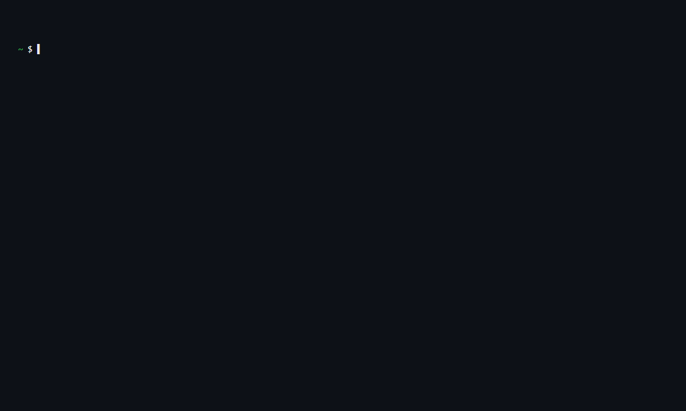

# DepBoard

<p align="center">
  
</p>

**Discover what's hiding in your projects in 10 seconds.**

```bash
npx depboard ~/projects
```

Every dependency tool answers _"what is outdated in this project?"_. DepBoard answers
_"what is happening across **all** my projects at once?"_. Point it at the folder that holds your
projects and it opens one matrix in your browser: every package, every project, every version.
That's where you find out that React runs at three different major versions across six projects,
or that a vulnerable lodash sits in four of them.

No account, no config, nothing uploaded. It runs on your machine and stops when you close it.

## What you get

- **The whole picture on one screen.** One row per package, one column per project. Each cell shows the
  installed version and how far behind it is: **P**atch, **m**inor, **M**ajor.
- **What's hiding, in plain sentences.** _"react is used at 3 different major versions across 6 projects"_,
  _"lodash has 4 known vulnerabilities (high) in 4 projects"_. Click one and the matrix narrows to it.
- **Known vulnerabilities** for every project from a single request to the npm advisory database, the
  same data `npm audit` uses, with details for each advisory.
- **One project at a time.** Open a project to see all its packages, most urgent first.
- **Update from the browser.** Pick a package in an npm project, see the exact command first
  (`npm install lodash@4.18.1 --no-audit --no-fund`), confirm, and watch the output live.
  Major updates ask for a second confirmation. The matrix refreshes when it's done.
- **A terminal summary** with `--summary`, for when you don't want a browser.

Works with projects managed by npm, pnpm, yarn, and bun. In 0.1, updating from the browser is npm only;
for the others DepBoard shows the command to run yourself.

### Planned

- Exact versions from lock files, for projects that were never installed (today these are estimated from
  `package.json` and shown in italics)
- Workspaces (monorepos) as separate projects, and vulnerabilities in transitive dependencies
- Updates for pnpm, yarn, and bun, and one package across many projects at once

## Usage

```bash
npx depboard                       # the current folder
npx depboard ~/projects            # one folder
npx depboard ~/work ~/clients      # several folders, one matrix
npx depboard ~/projects --summary  # print the findings and exit
```

| Option            | What it does                                      |
| ----------------- | ------------------------------------------------- |
| `--port <n>`      | Port to listen on (default: a random free port)   |
| `--no-open`       | Print the link instead of opening the browser     |
| `--summary`       | Print the summary and exit: no server, no browser |
| `--depth <n>`     | How deep to look for projects (default: 6)        |
| `-y`, `--yes`     | Skip confirmations                                |
| `--debug`         | Verbose logs to stderr                            |
| `-v`, `--version` | Print the version                                 |
| `-h`, `--help`    | Show the help                                     |

DepBoard skips `node_modules`, build output, virtualenvs, vendored code, and hidden folders. It refuses to
scan a whole drive and asks before scanning your entire home folder.

## Why DepBoard?

The tools below are good at what they do, and DepBoard doesn't replace them. It's the view none of them
give you: all your projects side by side.

| Tool                      | Scope                         | Where it runs        |
| ------------------------- | ----------------------------- | -------------------- |
| `npm outdated`, ncu, taze | One project at a time         | Terminal             |
| npm-gui                   | One project at a time         | Local browser UI     |
| Renovate, Dependabot      | One repository at a time      | Cloud, as PRs        |
| **DepBoard**              | **Every project in a folder** | **Local browser UI** |

## Security & privacy

DepBoard reads your projects and, unless you confirm an update, never writes to them.

- The server listens on `127.0.0.1` only. Every request needs a token created for this launch, and
  requests from other sites are refused (Host and Origin checks).
- Updates run `npm` directly, never through a shell, and only for a package and project from the scan.
- It asks the npm registry (`registry.npmjs.org`) for the latest version of each package, and its
  advisory database about the installed versions. Package names and versions are all it sends: no code,
  no paths, no telemetry, no account.

Found a security issue? Please report it privately; see [SECURITY.md](https://github.com/aaas72/depboard/blob/main/SECURITY.md).

## Requirements

Node.js 20.19 or newer, on Windows, macOS, or Linux.

## Contributing

Issues and pull requests are welcome. See [CONTRIBUTING.md](https://github.com/aaas72/depboard/blob/main/CONTRIBUTING.md)
to get from clone to a passing test run.

## License

[MIT](LICENSE). The published package bundles open-source dependencies (Fastify, React, and others), all
under permissive licenses; their notices ship in `dist/THIRD_PARTY_LICENSES.md`.
