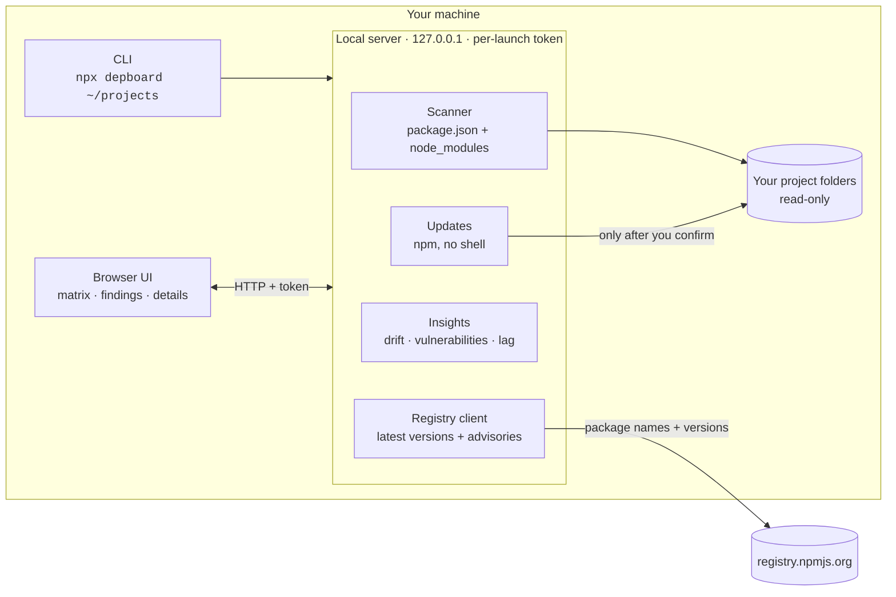

# Architecture

How DepBoard is built, and why. Read this before your first non-trivial change.

## The shape of it

DepBoard is one npm package, `depboard`. Running it starts a small HTTP server on `127.0.0.1`,
serves a React UI from it, and opens the browser. The server does all the work: scanning, registry
lookups, insights, updates. The browser only displays what the server sends; it never reads files
and never talks to the internet.

## Packages

The repository is a pnpm workspace. Only `cli` is published; it bundles the other three.

| Package           | Responsibility                                                              | Depends on            |
| ----------------- | --------------------------------------------------------------------------- | --------------------- |
| `packages/shared` | Domain types, error codes, insight wording. No Node or DOM code.            | nothing               |
| `packages/server` | Fastify server: scanner, registry client, insights, updates, security guard | `shared`              |
| `packages/web`    | React UI (Vite, Tailwind, TanStack Virtual)                                 | `shared` (types only) |
| `packages/cli`    | Arguments, root selection, terminal summary, starts the server              | `server`              |

`web` never imports from `server`, and the other way round. Types the two share live only in
`shared`. The `cli` build (tsup) bundles everything into `dist/index.js` and copies the built UI to
`dist/web`, so the published package has **zero runtime dependencies**
([ADR 0001](adr/0001-bundle-to-zero-runtime-dependencies.md)).

## A run, step by step

1. **Roots.** `depboard [paths...]` resolves the folders to scan: the given paths, or the current
   folder. Nested roots are merged. A drive root (`/`, `C:\`) is refused; the home folder needs
   confirmation (`--yes`).
2. **Scan.** Finds every `package.json` below the roots (max depth 6), skipping `node_modules`,
   build output, virtualenvs, vendored code, and every hidden folder. Symlinks are never followed.
   For each dependency it records the declared range and the installed version from `node_modules`
   (walking up like Node does, never above the root).
3. **Registry.** For each unique package, one request for its `latest` manifest (3 KB, never the
   full metadata, which can be 25 MB). Then one bulk request to the npm advisory endpoint for every
   installed version at once, the same endpoint `npm audit` uses. 16 requests in flight, 15 s
   timeout, one retry, a 15-minute in-memory cache.
4. **Matrix and insights.** Each cell gets an update type (computed on the server, never in the
   UI) and its highest advisory severity. Pure functions turn the matrix into ranked insights.
5. **Terminal summary.** The CLI prints the top findings, then hands the same result to the server
   so nothing is scanned twice.
6. **UI.** The browser opens `http://127.0.0.1:<port>/?token=…`. The UI moves the token out of the
   address bar into session storage and sends it as a header on every request.
7. **Updates.** On a confirmed update, the server runs `npm install <name>@<version>` in that
   project and streams the output to the UI. After success it rescans and the matrix refreshes.

## The data model

Defined once in `packages/shared/src/domain.ts`:

- `Project`: `id` (a stable hash of the path, never the path itself in URLs), `name`, `path`,
  `manager` (npm, pnpm, yarn, bun).
- `MatrixRow`: one package, its `latest` version, and a cell per project that uses it.
- `MatrixCell`: `declared` range, `installed` version (or `null`), `updateType`, `depType`, and
  `vulnerability` (`{ severity, count }`, `null`, or `unknown`).

`updateType` is a **risk level**, not "which digit changed": following SemVer, a minor bump below
1.0 counts as `major`. When nothing is installed, the version is estimated from the range and shown
in italics, and its vulnerability status is `unknown`: the range's floor can be vulnerable while the
version really in use isn't, or the reverse.

## Insights

The sentences at the top of the screen. A wrong insight costs more trust than a missing one, so each
rule reports only what the data proves:

| Kind                | Fires when                                                             | Example                                                       |
| ------------------- | ---------------------------------------------------------------------- | ------------------------------------------------------------- |
| `vulnerable-spread` | an **installed** version has a known advisory, in 1+ projects          | lodash has 4 known vulnerabilities (high) in 4 projects       |
| `version-drift`     | installed versions span 2+ **release lines** (the major, or 0.x minor) | react is used at 3 different major versions across 6 projects |
| `major-lag`         | 1+ majors behind `latest`, in 2+ projects                              | typescript is up to 3 major versions behind in 4 projects     |

Insights from one npm scope that tell the same story fold into one sentence
(`@angular/*` (8 packages) …). Ranking uses score bands: critical > high > drift > moderate > low >
lag, then more projects and bigger gaps first. The wording lives in `shared`, so the terminal and the
UI say exactly the same thing.

## Updates

- `adapters/npm.ts` builds the command as an argument array. It is a pure function, so the UI can
  show the exact command before anything runs, and tests cover it without running npm.
- `updates/plan-update.ts` checks every request against the scan: the project exists (by id), the
  package is declared there, the version is exact, a major update is confirmed.
- `updates/runner.ts` is the **only** place DepBoard starts a process: `execa` with `shell: false`.
- `updates/jobs.ts` allows one job per project, keeps a capped log, and stops jobs on shutdown.
- Only npm projects are updated in 0.1. For pnpm, yarn, and bun the UI shows the command to run by
  hand: running `npm install` inside a pnpm workspace would damage it.

## HTTP API

Internal: it exists for DepBoard's own UI and may change in any release. All routes need the token.

| Method | Path                   | Purpose                                                 |
| ------ | ---------------------- | ------------------------------------------------------- |
| GET    | `/api/projects`        | Scanned roots, home folder, projects, skipped files     |
| GET    | `/api/matrix`          | The matrix with insights                                |
| POST   | `/api/rescan`          | Scan again and return the new matrix                    |
| POST   | `/api/update`          | Plan (`dryRun`) or start an update; returns the command |
| GET    | `/api/jobs`            | Updates run in this session                             |
| GET    | `/api/jobs/:id/stream` | One update's output, as newline-delimited JSON          |

## Principles

- **Services don't know about Fastify.** The scanner, registry client, insights, and adapters are
  plain functions, tested without a server.
- **Dependencies are injected** through `createApp(options)`: tests pass a fake registry and a fake
  process runner.
- **No database.** All state is in memory and gone when DepBoard stops.
- **Decisions with a real alternative get an ADR** in [docs/adr](adr/).

See also: [security model](security-model.md) · [UI guidelines](ui-guidelines.md) ·
[contributing](../.github/CONTRIBUTING.md).
