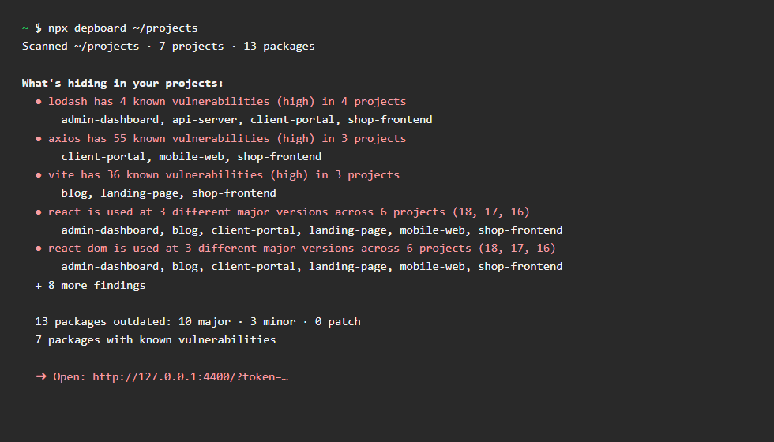
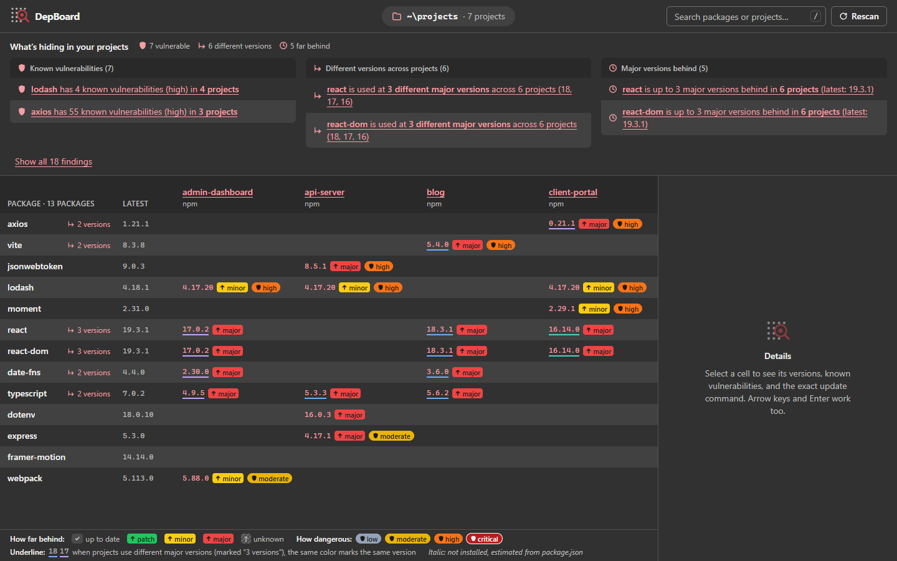

# Getting started

## Requirements

- **Node.js 20.19 or newer.** Check with `node --version`.
- Windows, macOS, or Linux. Nothing to install: `npx` downloads DepBoard on first use.

## Your first run

Point DepBoard at the folder that holds your projects:

```bash
npx depboard ~/projects
```

On Windows, in PowerShell or `cmd.exe`, `~` works too, or give the full path:

```powershell
npx depboard C:\Users\you\projects
```

Within seconds:

1. **The terminal prints what it found:** how many projects and packages, and the top findings.

   

2. **Your browser opens the matrix.** If it doesn't, open the `➜ Open:` link from the terminal.

   

3. **Start with the findings at the top.** They are the things worth knowing: a vulnerable package
   in several projects, one package used at several major versions, projects far behind. Click one
   and the matrix narrows to it.

DepBoard keeps running until you press `Ctrl+C` in the terminal. Nothing is left behind when it
stops.

## Choosing what to scan

| Command                         | Scans                                         |
| ------------------------------- | --------------------------------------------- |
| `npx depboard`                  | The current folder                            |
| `npx depboard ~/projects`       | One folder and everything below it            |
| `npx depboard ~/work ~/clients` | Several folders, shown together in one matrix |

DepBoard looks up to 6 folders deep (`--depth` changes it). It skips `node_modules`, build output,
Python virtualenvs, vendored code, and hidden folders, and never follows symbolic links.

It never scans more than you ask: a whole drive (`/`, `C:\`) is refused, and your entire home
folder needs confirmation. Point it at the folder that holds your projects instead.

### Only one project, or none?

- **One project found:** the matrix shows it, with a hint to include its neighbors. DepBoard is at its
  best comparing several projects: `npx depboard ..` scans the parent folder.
- **No projects found:** DepBoard suggests common project folders that exist on your machine, such as
  `~/projects` or `~/code`. It only checks that they exist; it doesn't scan them until you run the
  suggested command.

## Next

- [Reading the matrix](reading-the-matrix.md): what every badge, color, and line means.
- [Updating packages](updating.md): update a package from the browser, safely.
- [Command-line reference](cli.md): every option, and how to use DepBoard in scripts.
