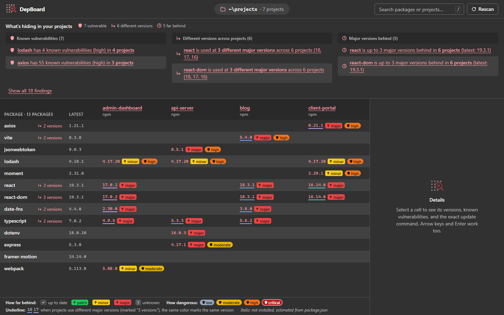
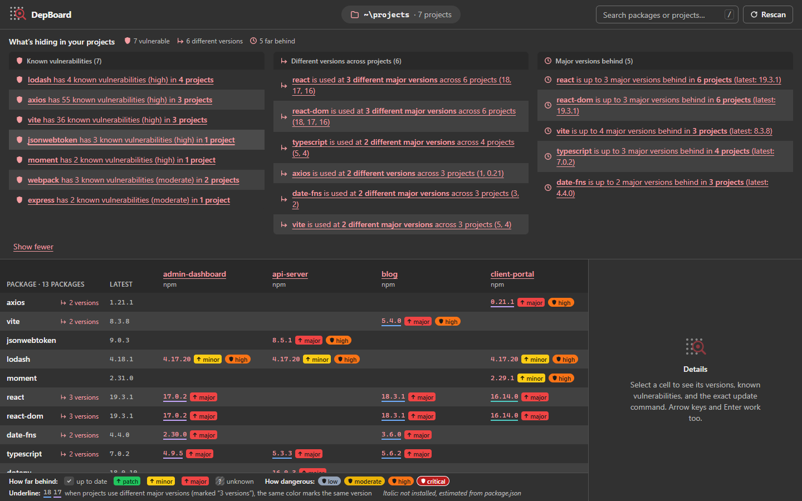
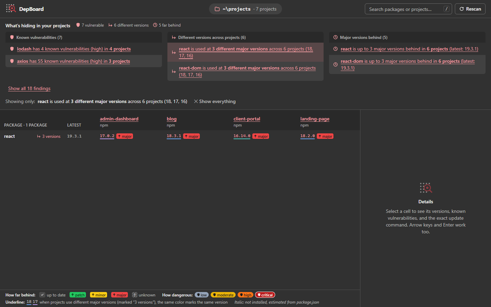
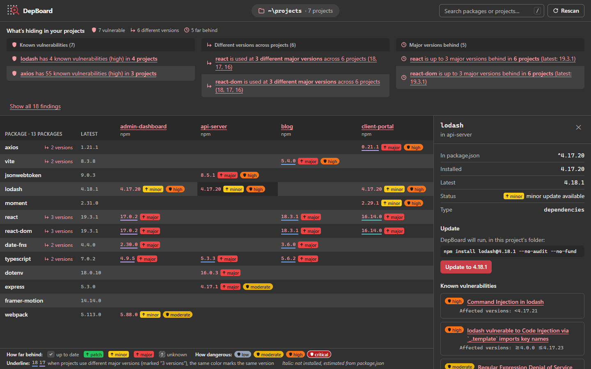
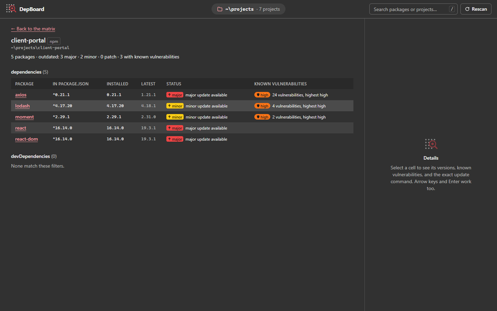

# Reading the matrix

The screen has four parts, top to bottom: the header, the findings, the matrix, and the legend.
The details panel on the right fills when you select a cell.

## The header

The capsule in the middle names exactly what was scanned (`~/projects · 7 projects`), so you never
have to wonder whether DepBoard read more than you asked. On the right: search (press `/`), a
**Hide up-to-date** switch that names how many packages it would hide, and **Rescan**.

## The findings

"What's hiding in your projects" sums up what deserves your attention, in plain sentences, in three
columns:

| Column                                   | Means                                                                  |
| ---------------------------------------- | ---------------------------------------------------------------------- |
| 🛡 **Known vulnerabilities**              | An installed version has a published advisory, in one or more projects |
| ↳ **Different versions across projects** | Your projects use a package at different major versions                |
| 🕓 **Major versions behind**             | Projects are one or more major versions behind the latest release      |

Each column shows its two most important findings; **Show all** lists the rest. Click a finding and
the matrix narrows to that package and the projects involved; **Show everything** brings the full
matrix back.

A finding only states what DepBoard can prove. A vulnerability is reported only for a version that is
really installed, and version differences count only installed versions.

## The matrix

One row per package, one column per project. The **Latest** column is the newest version on npm.

### A cell

A cell shows the version the project uses, and up to two badges:

| How far behind | Badge     |     | How dangerous | Badge        |
| -------------- | --------- | --- | ------------- | ------------ |
| up to date     | `✓`       |     | low           | `🛡 low`      |
| patch behind   | `↑ patch` |     | moderate      | `🛡 moderate` |
| minor behind   | `↑ minor` |     | high          | `🛡 high`     |
| major behind   | `↑ major` |     | critical      | `🛡 critical` |
| unknown        | `?`       |     |               |              |

- **patch:** bug fixes; usually safe to update.
- **minor:** new features; should stay compatible.
- **major:** may contain breaking changes. Below version 1.0, a minor bump counts as major, as
  Semantic Versioning says.
- **?** means the npm registry couldn't be reached for that package.

An **empty cell** means the project doesn't use that package.

### Versions in italics

The package isn't installed in that project (no `node_modules`), so DepBoard shows the lowest version
its `package.json` range allows. That is an estimate, and its vulnerability status is unknown. Run
`npm install` in the project, then **Rescan**, to see the real picture.

### Version drift

When projects use a package at different major versions, the package name says so:
**react ↳ 3 versions**. The colored line under each version shows which projects share one: the same
color means the same major version. Here, one color marks every project on React 18, another every
project on React 17.

### Order

Packages with high or critical vulnerabilities come first, then those with version drift, then the
most outdated, then the rest by name. Projects are ordered the same way: the ones with the most
serious problems on the left, so they are on screen without scrolling.

## The details panel

Select a cell (click it, or move with the arrow keys and press `Enter`) to see:

- the range in `package.json`, the installed version, and the latest version;
- every known vulnerability, with its severity, the affected versions, and a link to the advisory;
- the **Update** button, with the exact command it will run. See [Updating packages](updating.md).

## One project at a time

Click a project's name in the column header to see all of its packages, split into dependencies and
devDependencies, the most urgent first.

## Keyboard

| Key                      | Action                                |
| ------------------------ | ------------------------------------- |
| Arrow keys               | Move between cells                    |
| `Enter`                  | Open the selected cell's details      |
| `Esc`                    | Close the details, back to the matrix |
| `Esc` in the search box  | Clear the search                      |
| `Home` / `End`           | First or last cell of the row         |
| `Ctrl+Home` / `Ctrl+End` | First or last row                     |
| `PageUp` / `PageDown`    | Jump a screen up or down              |
| `/`                      | Search                                |
