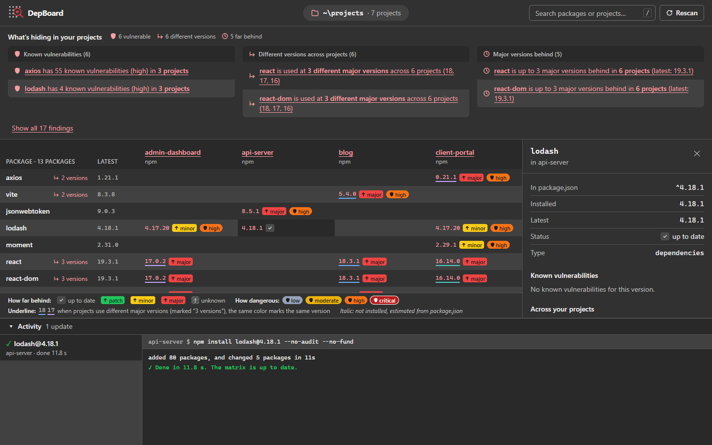

# Updating packages

DepBoard is read-only until you ask for an update. When you do, it shows the exact command first and
runs only that.

## Update one package in one project

1. Select the cell: the package, in the project you want to update.
2. The details panel shows the command, for example:

   ```
   npm install lodash@4.18.1 --no-audit --no-fund
   ```

3. Press **Update to 4.18.1**. The command runs in that project's folder, and its output streams live
   into the **Activity** panel at the bottom.
4. When it succeeds, DepBoard scans again and the matrix shows the new version.

   

A dev dependency keeps its place: the command includes `--save-dev`.

## Major updates ask first

A major update can break code. Its button ends with `…`: pressing it opens a dialog that repeats the
exact command and links to the package's versions on npm. Nothing runs until you press **Run the
update**. The dialog's focus starts on **Cancel**.


## What DepBoard will and won't do

- It runs `npm` or `pnpm` directly, never through a shell, so a package name can never become a
  command.
- It updates only a package the project already declares, to an exact version.
- It runs one update per project at a time.
- It never touches other projects, and never runs anything you didn't confirm.
- If the command fails, the Activity panel shows its exit code and output, and the matrix stays as it
  was.

## yarn and bun projects

DepBoard reads projects of every package manager, and in this version it updates standalone **npm**
and **pnpm** projects. For **yarn** and **bun**, the details panel shows the command to run yourself
in the project folder. Running the wrong package manager inside a project could damage its lock file,
so DepBoard never guesses. Updates for yarn and bun are on the [roadmap](../roadmap.md).

## Monorepos

A monorepo shows as one project. Updating a dependency inside it depends on which of its packages
declares it, and the wrong command can damage the workspace, so DepBoard doesn't offer an update
there yet. The details panel shows which packages use which version; update it in that package
with your package manager.
